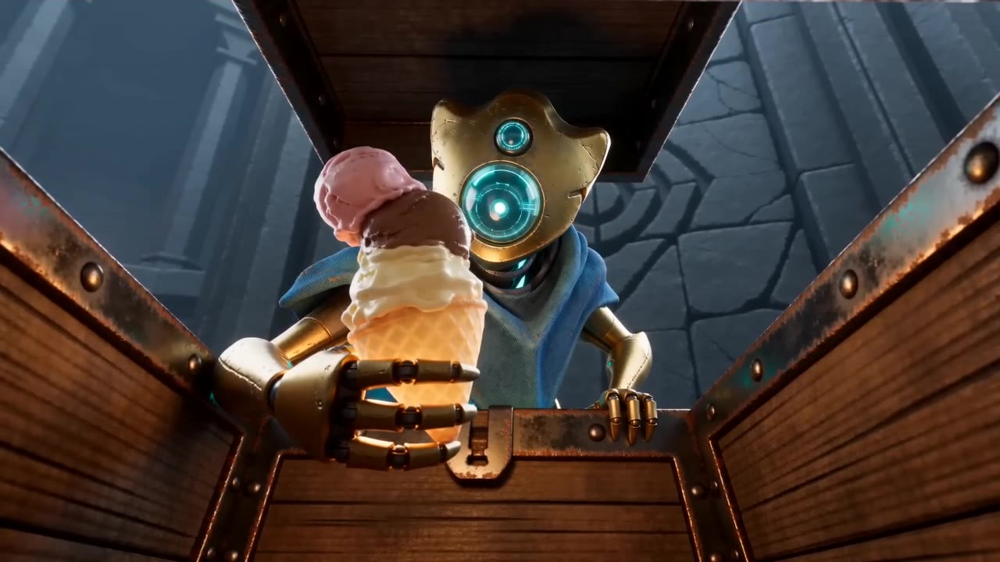

# 一支冰淇淋的代价 · AIGC 影像作品集

围绕《杀戮尖塔》故障机器人“鸡煲”的同人短片：想拿到冰淇淋遗物，却接连遇上追兵、深渊与Boss。记录从玩家梗、角色资产、导演提示词到生成迭代的过程。

更新：新增四张新版人设与道具设定图，旧图归入“初版人设图”；提供[35秒剪辑预览](media/previews/film-v1.mp4)。预览由FFmpeg制作，剪映实际打开、播放与导出仍未验证。

**[打开作品集网站](https://con3eited-dot.github.io/aigc-spire-portfolio/)**

## 观看

- [01 · 塔外苏醒](media/originals/opening.mp4)
- [02 · 拿遗物，版本二](media/originals/chase-v2.mp4)
- [03 · 崖底与时光老头](media/originals/ending.mp4)

三段独立生成，网页支持依次播放；另附35秒剪辑预览。主展示采用作者明确选定的版本二，其余完成版本保存在档案中。

## 制作与复盘

作者构思约一整天；测试可灵与TapNow后，最终选用即梦普通会员制作视频。AI协助编写人设、场景和镜头调度提示词。

针对冰淇淋路径偏离预期、怪物缺少解封过程的问题，作者重新与GPT沟通并迭代提示词。当前中段动作不够自然、怪物出场偏僵硬、冰淇淋移动路径仍未完全满意；网站将观察结果、修改方法与未解决的问题分开展示。

## 可复用 Skills

- [参考素材 → 人设图](skills/reference-character-sheet/SKILL.md)
- [故事 → 导演分镜提示词](skills/video-director-prompt/SKILL.md)
- [分段成片 → 连续叙事](skills/short-film-continuity/SKILL.md)
- [素材审片 → 视频剪辑](skills/editing-ai-clips/SKILL.md)

[下载四个Skills](downloads/creative-skills.zip) · [下载全部提示词](downloads/prompt-library.zip)

Skills按照`skills/<name>/SKILL.md`组织，可直接阅读或复制到支持Agent Skills的工具中。它们是可复用方法，不代表已经验证了剪映软件兼容性。

## 内容目录

- `media/`：原视频、网页播放版、人设图、角色与道具参考、早期静态画风测试。
- `prompts/`：导演提示词的当前整理稿与迭代工作稿。
- `skills/`：四个技能及必要参考文件。
- `notes/`：早期画风研究的资料出处和边界说明。
- `asset-manifest.json`：原始素材文件名、发布路径、大小和SHA-256，便于核对。

网站是无需构建的HTML/CSS/JavaScript静态页面，由GitHub Pages发布。

游戏角色、原始美术与参考素材权利归各自权利人所有；本项目为个人同人创作练习。详见[素材与创作说明](credits.md)。传播策划为练习，尚无真实投放或表现数据。
